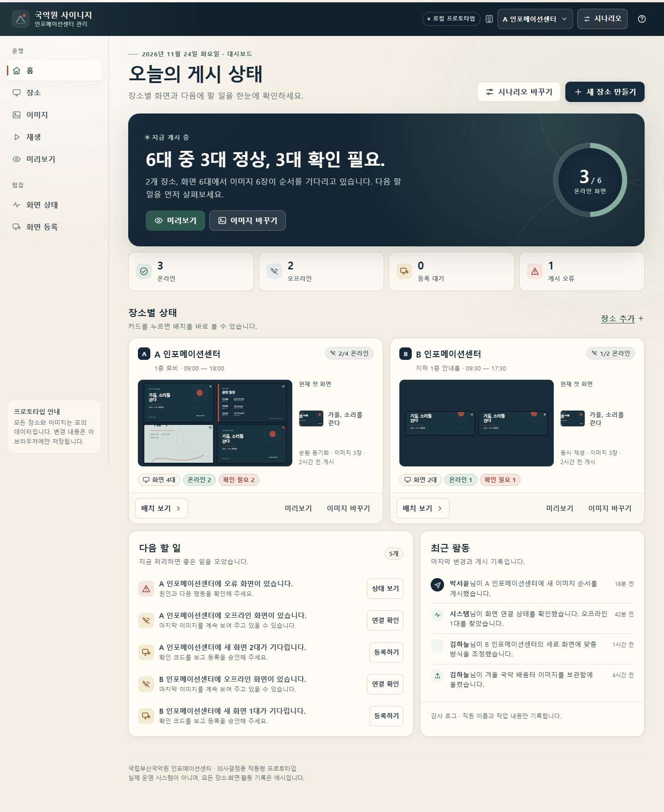

# 국립부산국악원 인포메이션센터 디지털 사이니지

인포메이션센터 2곳의 기존 모니터와 PC를 활용해, 별도 예산 없이 운영 가능한 **범용 이미지 송출 시스템**을 만드는 프로젝트입니다. 모니터 수·배치·해상도·방향을 코드에 고정하지 않고, 장소마다 설정으로 운영하는 것을 목표로 합니다.

공개 저장소: <https://github.com/toxicyou25-afk/GugakSignage>

[](https://github.com/toxicyou25-afk/GugakSignage/actions/workflows/ci.yml)

공개 데모(설치 없이 화면 보기): <https://toxicyou25-afk.github.io/GugakSignage/>

## 현재 단계

- 2026-11-24: 오픈소스 후보 조사, 범용 아키텍처 설계, 다중 모니터 동기화 시뮬레이션 완료
- 2026-11-24: 국내외 실제 서비스 화면·매뉴얼·데모·KRDS 벤치마킹 착수
- 2026-11-24: 독자 UI·UX 설계와 작동형 프로토타입 착수
- 2026-11-24: **범용 엔진·서버·브라우저 플레이어·가상 미리보기 PoC 완료** (단위·통합 61/61, 시나리오 63/63, 미리보기 48/48, 4화면 브라우저 65초 불일치 0건)
- 2026-11-24: **1차 동작본(관리 서버 + 윈도우 재생기) 구현·로컬 검증 완료** — SQLite, 한글 관리 화면, 콘텐츠·기기·재생목록·게시 API, 오프라인 캐시 재생기
- 2026-11-24: **장소·다중 모니터·화면별 배정 통합** — 기존 기기를 보존하는 SQLite 마이그레이션, 4화면 관리·RenderPlan 미리보기·브라우저 캔버스 재생 확인
- 2026-11-24: **독자 한국어 UI·UX 프로토타입 완료** (Playwright 1440·1280·768 스모크 통과, 원본 스크린샷 14장)
- 2026-11-24: **Apache-2.0 오픈소스로 공개**
- 장비 모델·운영체제·연결 방식·기존 프로그램 정보는 담당 직원 확인 대기

## 핵심 요구

- 1대~다수 모니터, 장소별 독립 그룹
- 가로·세로·격자·사용자 지정 배치
- 모니터별 해상도·방향, 자동 인식·수동 등록
- 이미지 규격 검사·비율 유지
- 개별·순환·동시·통합 화면 재생
- 이미지 수와 모니터 수가 달라도 동작
- 모니터 추가·연결 해제 대응
- 실제 송출 전 가상 모니터 미리보기
- 관리 프로그램·재생 엔진·송출 모듈 분리
- 일반 직원이 매뉴얼 없이 쓰는 한글 관리 화면
- 기존 장비·무료 오픈소스 우선, 외부 클라우드·유료 API 의존 없음

## 문서

- [후보 조사](docs/research/candidates.md)
- [현장 장비 확인 목록](docs/research/equipment-checklist.md)
- [범용 아키텍처](docs/design/architecture.md)
- [동기화 설계·시뮬레이션](docs/design/sync.md)
- [UI·UX 설계 원칙](docs/design/ui-ux.md)
- [권고안](docs/design/recommendation.md)
- [단계별 계획](docs/plan.md)
- [PoC 실행·검증](poc/README.md)
- [MVP 실행·구성](docs/design/mvp-runtime.md)
- [다중 모니터 데이터·API·재생 계약](docs/design/multimonitor.md)
- [MVP 검증 기록](docs/verification/mvp.md)
- [UI 프로토타입](prototype/README.md)
- [오픈소스 운영 원칙](docs/OPEN_SOURCE.md)
- [기여 안내](CONTRIBUTING.md)
- [보안 정책](SECURITY.md)

## 저장소 구조

- `docs/` — 조사, 설계, 장비 확인 목록, 단계별 계획
- `src/`, `public/` — 1차 MVP 관리 서버와 한글 관리 화면·웹 재생기
- `seed/` — 첫 실행 시 들어가는 샘플 포스터·영상·재생목록
- `test/`, `scripts/` — API 테스트와 로컬 브라우저 검증
- `start-player.cmd` — 윈도우 Edge/Chrome 전체화면 재생기 실행 스크립트
- `prototype/` — 독자 한국어 UI·UX 작동형 프로토타입
- `poc/` — 범용 재생 엔진·서버·브라우저 플레이어·가상 미리보기 PoC
- `tools/` — 현장 장비 정보 수집·진단 도구(작성 예정)

## PoC 실행

Node.js 20 이상만 있으면 됩니다. Docker·DB·패키지 설치 없이 실행됩니다.

```powershell
cd poc
npm start -- --port 4174
```

- 미리보기 A: `http://127.0.0.1:4174/preview/?site=site-a`
- 플레이어 A-01: `http://127.0.0.1:4174/player/?site=site-a&display=disp-a1`
- 자동·수동 등록: `http://127.0.0.1:4174/player/`

자세한 데모 사이트·이미지 수·모드·검증 명령은 [poc/README.md](poc/README.md)에 있습니다.

### 검증 결과(2026-11-24, 로컬)

| 항목 | 결과 |
|---|---|
| 단위·통합 테스트 | 61/61 통과 |
| 결정론적 시나리오 | 63/63 통과 (48개 매트릭스) |
| 미리보기 브라우저 | 48/48 통과 |
| 4화면 동기화 | 65.4초, 이미지 순서 불일치 0건, 최대 전환 편차 10.2ms, 최대 지연 17.6ms |
| 오프라인·재시작 | 오프라인 유지·새로고침 복구·같은 epoch 재시작 복구 확인 |

이 결과는 로컬 loopback과 4개 브라우저 컨텍스트 기준입니다. 실제 4대 모니터·장시간 1시간 소크·물리 PC 간 네트워크는 아직 검증하지 않았습니다.

## 1차 동작본(MVP): 관리 서버 + 윈도우 재생기

owner가 확정한 1차 범위는 **관리 서버와 윈도우 PC 재생기**입니다. 관리자 페이지가 기본 화면이며, 재생기는 대시보드나 기기 카드의 **재생기 실행** 버튼으로 시작합니다. 관리 화면에서 콘텐츠를 올리고, 기기에 등록 코드를 발급하고, 재생목록·시간표를 저장·게시하면 실행한 재생기가 전체화면으로 순환 재생합니다. 서버가 끊기면 재생기는 마지막 목록을 로컬 캐시에서 계속 재생합니다.

이 MVP는 이제 **장소 → 화면 그룹 → 모니터·배치 → 화면별 재생목록** 흐름과 **다중 모니터 동기화·가상 미리보기**를 포함합니다. 기존 기기·재생목록·시간표 API는 그대로 남아 있고, 장소·화면 게시는 `poc/packages/engine`의 기존 `buildLayout`·`buildRenderPlan`을 서버 미리보기와 브라우저 재생기가 함께 사용합니다. 세부 계약은 [다중 모니터 설계](docs/design/multimonitor.md)에 있습니다.

### 30분 실행 절차

준비물은 Node.js 24 이상(또는 Docker Desktop)과 Edge/Chrome입니다. 첫 실행 시 샘플 포스터 3장, 동영상 1개, 안내 URL, 재생목록 1개, 등록 코드 **GUGAK1**인 샘플 기기가 자동으로 들어갑니다.

**1) 서버 실행 — Docker Compose 첫 설정**

```powershell
if (-not (Test-Path .env)) { Copy-Item .env.example .env }
docker compose -f docker-compose.local.yml up --build -d
```

**1) 서버 실행 — Node.js (Docker 없이)**

```powershell
npm ci
npm run dev
```

- 관리 화면: <http://localhost:3000/admin/>
- 재생기: <http://localhost:3000/player/>
- 새 DB의 테스트 기본 비밀번호: `0000`
- 데이터: `data/signage.sqlite`, 업로드 파일: `data/uploads/`

기존 `.env`에 `ADMIN_PASSWORD`가 있거나 DB에 이미 관리자 비밀번호가 저장되어 있으면 기존 비밀번호를 유지합니다. 설정 화면에서 바꾼 비밀번호는 DB에 해시로 저장되어 서버를 다시 시작해도 유지되며, 변경할 때 모든 관리자 세션이 종료됩니다.

#### 관리자 LAN 공개 순서

관리자 네트워크 제한은 요청마다 DB에 저장된 현재 비밀번호 상태를 확인합니다. **로컬 초기 설정 → 로컬에서 비밀번호 변경 → 필요한 경우 HOST·포트 공개·방화벽 적용** 순서를 지키세요.

- 새 DB의 비밀번호가 `0000`인 동안 로그인·관리 세션·보호 API와 `/admin/` 화면은 실제 TCP peer가 loopback일 때만 허용됩니다. LAN IP로 들어온 관리자 요청은 `403`으로 거부합니다. `X-Forwarded-For`, `Forwarded`, `Via`, `CF-Connecting-IP` 같은 전달 헤더는 주소 판정에 쓰지 않습니다. 초기 설정 중에는 전달 헤더가 붙은 loopback 요청도 fail-closed로 거부하며, 같은 PC의 reverse proxy를 통한 초기 설정은 지원하지 않습니다.
- 비밀번호를 `0000`이 아닌 값으로 바꾸면 서버는 재시작 없이 다음 관리자 요청부터 LAN을 허용합니다. 기존 관리자 세션은 모두 종료되므로 새 비밀번호로 다시 로그인합니다.
- 기존 DB의 비밀번호가 이미 `0000`이 아니면 제한은 처음부터 적용되지 않아 기존 LAN 동작이 유지됩니다.

| 실행 방식 | 초기 네트워크 설정 | `0000`일 때 | 비밀번호 변경 후 LAN 전환 |
|---|---|---|---|
| Node 직접 실행 | `.env`의 `HOST`(기본 `0.0.0.0`) | loopback만 허용 | `HOST=0.0.0.0`이면 재시작 없이 허용. `HOST=127.0.0.1`이면 `HOST`를 바꾸고 재시작 |
| Docker 첫 설정 | `docker-compose.local.yml`이 `127.0.0.1:3000`에만 게시 | 컨테이너에는 호스트 접속이 loopback으로 보이지 않아 차단 | 컨테이너 안에서 `npm run admin:change-password` 실행 후 일반 Compose로 재시작 |
| Docker 기존 설치 | `docker-compose.yml`이 `3000:3000` 게시 | loopback만 허용 | 실행 중인 컨테이너에서 `docker compose exec signage npm run admin:change-password` 실행. 포트 게시가 이미 LAN이면 재시작 없이 허용 |
| Windows 설치본 | 데이터 폴더 `.env`의 `HOST=0.0.0.0`(기본 `%ProgramData%\GugakSignage\.env`) | loopback만 허용 | 서버 PC에서 `http://127.0.0.1:<PORT>/admin/`로 변경. 방화벽 TCP 포트가 열려 있으면 재시작 없이 허용 |

**Node.js 직접 실행**

```powershell
npm ci
npm run dev
```

같은 PC에서 <http://localhost:3000/admin/>에 로그인해 **설정**에서 비밀번호를 바꿉니다. `.env`의 `HOST`가 `0.0.0.0`이면 변경 즉시 LAN 관리가 허용됩니다. `HOST=127.0.0.1`이면 LAN 관리와 재생기 제공을 위해 `HOST=0.0.0.0`으로 바꾸고 서버를 재시작합니다. Windows 방화벽에서 TCP 3000(또는 지정한 `PORT`)을 허용해야 합니다.

**Docker 첫 설정과 LAN 전환**

`docker-compose.local.yml`은 호스트 loopback에만 포트를 게시합니다. 컨테이너 NAT에서는 호스트 브라우저의 접속도 loopback으로 보이지 않으므로 초기 관리자 화면은 fail-closed로 거부됩니다. 아래 명령으로 컨테이너 안의 loopback을 통해 비밀번호를 바꿉니다. 입력값은 화면에 표시되지 않습니다.

```powershell
docker compose -f docker-compose.local.yml exec signage npm run admin:change-password
```

그다음 로컬 전용 컨테이너를 종료하고 일반 Compose 파일로 재시작합니다. `down`에 `-v`를 붙이지 마세요. 이름 있는 데이터 볼륨을 보존합니다.

```powershell
docker compose -f docker-compose.local.yml down
docker compose up --build -d
```

이미 `docker-compose.yml`로 실행 중인 설치에서 DB 비밀번호가 `0000`이면 컨테이너를 재시작하지 않고 `docker compose exec signage npm run admin:change-password`로 바꿀 수 있습니다. `SESSION_SECRET`도 `.env`에서 고유한 값으로 설정하세요.

**Windows 설치본**

Windows 설치 프로그램은 Draft PR #4의 설치본을 기준으로 하며, 데이터 폴더의 `.env`를 사용합니다. 기본 데이터 폴더는 `%ProgramData%\GugakSignage`이고 기본 `HOST`는 `0.0.0.0`입니다. 서버 PC에서 <http://127.0.0.1:3000/admin/>에 접속해 비밀번호를 바꾸면, 포트와 방화벽이 LAN에 열려 있는 경우 재시작이나 재설치 없이 다른 PC에서 관리자 로그인을 사용할 수 있습니다. 설치 시 방화벽 규칙을 만들지 않았다면 관리자 PowerShell에서 설치 스크립트를 `-ConfigureOnly -OpenFirewall`로 다시 실행하거나 조직 방화벽 정책으로 TCP 포트를 엽니다. `HOST`나 `PORT`를 바꾼 경우에만 `set-autostart.ps1 -Restart`로 서버를 재시작합니다.

기본 설치 폴더 기준 명령입니다.

```powershell
# 방화벽 규칙은 필요한 경우에만
& "$env:ProgramFiles\GugakSignage\tools\install.ps1" -ConfigureOnly -OpenFirewall

# .env의 HOST나 PORT를 바꾼 경우에만
& "$env:ProgramFiles\GugakSignage\tools\set-autostart.ps1" -Restart
```

`ADMIN_PASSWORD`는 새 DB를 만들 때만 쓰입니다. DB의 비밀번호를 바꾼 뒤 `.env`에 `0000`이 남아 있으면 DB를 새로 만들 때 다시 기본 비밀번호가 될 수 있으므로, 운영 절차에 맞춰 `.env` 값도 갱신하거나 제거하세요.

**2) 관리 화면 로그인 → 기기에서 등록 코드 확인**

1. Node 실행은 <http://localhost:3000/admin/>에 접속합니다. 새 DB이며 `ADMIN_PASSWORD`가 지정되지 않은 테스트 환경에서는 기본 비밀번호 `0000`으로 로그인합니다. Docker 첫 설정은 위의 대화형 명령으로 비밀번호를 변경한 뒤 일반 Compose로 전환하세요.
2. 왼쪽 **기기** 메뉴를 엽니다. 샘플 기기 **로비 안내 화면** 카드에 큰 글씨로 **등록 코드 `GUGAK1`**이 표시됩니다.
3. 코드 옆의 `복사`를 누르거나 **재생기 실행**을 누릅니다. 새 기기를 만들었다면 그 카드의 6자리 코드를 사용합니다.

테스트 기본 비밀번호를 사용하면 로그인 화면과 관리자 화면에 로컬 전용 안내가 표시됩니다. Node 실행은 관리자 화면의 **설정**에서 현재 비밀번호를 확인하고 새 비밀번호를 저장할 수 있습니다. 비밀번호 변경 시 기존 세션이 종료되므로 새 비밀번호로 다시 로그인하고, LAN 관리는 HOST·포트 공개와 방화벽 설정을 확인하세요. 재생기를 코드 없이 열어도 첫 화면의 **관리 화면에서 등록 코드 확인** 링크와 **샘플 코드 `GUGAK1`로 연결** 버튼으로 바로 시작할 수 있습니다. 직접 주소는 <http://localhost:3000/player/?code=GUGAK1>입니다.

**3) 윈도우 재생기 실행**

Windows 설치본은 관리자 대시보드나 **기기** 카드의 **재생기 실행** 버튼으로 재생기를 시작합니다. 서버가 기록한 로컬 실행 요청을 watchdog이 받아 설치된 Edge 앱 창으로 엽니다. **중지**를 누르거나 재생기 창을 닫으면 자동으로 다시 열지 않습니다. 개발 중 서버만 직접 실행했을 때는 아래 스크립트를 수동으로 사용할 수 있습니다.

```powershell
.\start-player.cmd
# 같은 PC에서 샘플 코드로 바로 시작할 때
.\start-player.cmd "http://localhost:3000/player/?code=GUGAK1"
# 다른 PC에서 접속할 때(관리 화면 기기 카드의 코드 사용)
.\start-player.cmd "http://192.168.0.20:3000/player/?code=GUGAK1"
```

- Edge가 있으면 Edge 전체화면 앱 모드(`--app` + `--start-fullscreen`), 없으면 Chrome 키오스크(`--kiosk`)를 엽니다. Edge의 `--kiosk`는 InPrivate로 열려 등록 정보와 캐시가 종료 시 지워지므로, 캐시 유지를 위해 앱 모드를 씁니다. 두 방식 모두 주소창 없는 전체화면이며 전용 프로필(`%LOCALAPPDATA%\GugakSignagePlayer`)로 등록 정보를 유지하고, CSS로 커서를 숨깁니다.
- 처음 한 번은 관리 화면의 6자리 코드를 입력합니다. `?code=`가 포함된 주소로 열면 자동 연결되고, 코드가 없으면 첫 화면의 샘플 코드 버튼이나 관리 화면 링크를 쓸 수 있습니다.
- Windows 설치본의 로그온 자동 실행은 watchdog 작업이 관리자 페이지를 열고, 재생기는 관리자 버튼을 기다립니다. `start-player.cmd`를 `shell:startup`에 넣어 재생기를 자동 실행하지 마세요. PC 절전 해제와 자동 로그온은 현장 정책에 맞춰 별도로 설정하세요.

**4) 내 콘텐츠로 바꾸기 — 업로드 → 재생목록 → 게시**

1. **콘텐츠**에서 이미지·동영상을 끌어다 놓거나 URL을 추가합니다.
2. **재생목록**에서 새 목록을 만들고 콘텐츠를 추가한 뒤 표시 시간·맞춤 방식·순서를 저장합니다.
3. **기기 → 재생 설정**에서 기본 재생목록이나 시간표를 지정하고 `저장 후 게시`를 누릅니다. 기존 기기는 `게시` 버튼으로 새 버전을 배포할 수 있습니다.

**4-1) 여러 모니터를 한 장소로 묶기**

1. **장소·화면**에서 장소를 만들고 PC 기기를 선택합니다.
2. 모니터 수·해상도·가로/세로·회전·가로/세로/격자 배치와 서버 시각 동기 주기를 저장합니다.
3. 각 화면에 재생목록을 배정합니다. 빈 값은 그룹 기본 재생목록을 사용합니다.
4. `미리보기 새로고침`에서 실제 RenderPlan을 확인한 뒤 `게시`합니다.
5. 한 PC가 여러 모니터를 구동하면 기본 재생기 주소가 한 창의 다중 화면 캔버스를 엽니다. 모니터마다 브라우저 창을 따로 띄울 때는 `/player/?display=<모니터 ID>`를 사용합니다. PC가 다르면 각 기기 카드의 등록 코드로 재생기를 연결합니다.

**5) 오프라인 동작 확인**

재생기가 목록과 파일을 한 번 받은 뒤 서버를 끄면(`Ctrl+C` 또는 `docker compose stop`) 좌측 상단에 `오프라인 · 마지막 목록을 재생 중` 배지가 나타나고 이미지·동영상 순환이 계속됩니다. 서버를 다시 켜면 15초 주기로 새 버전을 확인합니다.

### 집 PC에서 이어서 실행

다른 PC에서는 GitHub에서 브랜치를 받아 같은 샘플로 시작할 수 있습니다.

```powershell
git clone https://github.com/toxicyou25-afk/GugakSignage.git
cd GugakSignage
git switch feat/signage-mvp-player
npm ci
npm run dev
```

- 관리 화면: <http://localhost:3000/admin/> / 신규 테스트 DB의 기본 비밀번호 `0000`
- 샘플 기기 코드: **`GUGAK1`** (기기 메뉴 → 로비 안내 화면 카드)
- 샘플 포스터·영상·재생목록 시드는 `seed/`에 포함되어 첫 실행 시 `data/uploads/`와 SQLite DB로 복사·생성됩니다.
- **실제 업로드 콘텐츠, `data/signage.sqlite`, `data/uploads/`, `.env`, `node_modules/`는 Git에 포함되지 않습니다.** 새 클론은 항상 샘플 데이터로 시작하며, 기존 운영 데이터가 필요하면 별도로 백업·복원해야 합니다.
- `.env`를 쓰려면 `.env.example`을 복사합니다. 운영 전에 관리 화면에서 비밀번호를 바꾸고 `SESSION_SECRET`을 고유한 값으로 변경합니다.

### 검증 결과

| 명령 | 결과 |
|---|---|
| `npm run typecheck` | 통과 |
| `npm test` | 통과 — 51/51, 0 실패. 재생기 실행·중지 명령의 서버 인스턴스/TTL 검증, 무관한 PID 채택 거부, 정상 Edge 채택·종료 전 재검증, watchdog 시작 시 관리자 페이지 열기 판단, 현재 송출 모델, 기본 비밀번호 loopback 허용·LAN 차단 포함 |
| `npm run verify:first-run` | 통과 — 관리자 비밀번호 경고·설정 변경·이전 비밀번호 거부·재시작 후 로그인·샘플 기기와 재생기 검증 |
| `npm run verify:ui` | 통과 — 샘플 배너·4단계 링크, 재생기 실행/중지 버튼, 재생기가 꺼진 현재 송출 목록, 코드 없는 재생기 첫 화면·샘플 원클릭 연결·404 안내, 관리 화면 업로드·재생목록·게시, 현재 항목 강조, 재생기 영상·URL, IndexedDB 캐시, 서버 종료 후 다음 항목 재생, 오프라인 재실행 |
| `npm run verify:schedule` | 통과 — 기본 목록 없는 시간표 전용 기기에서 온라인 시작과 서버 단절 중 다음 시간대 자동 시작 |
| `npm run verify:multimonitor` | 통과 — 격리 DB에서 4화면 설정·화면별 콘텐츠·PC 배정·RenderPlan 미리보기·게시, URL 단독 iframe·오프라인 대체 화면, 한 PC 4화면 캔버스, 모니터별 분리 창 |
| `npm run verify:sw-update` | 통과 — 같은 persistent Edge profile에서 v3 셸 캐시 후 같은 origin에 HEAD 배포, `registration.update()` 뒤 v4 캐시·새 player.js·URL engine 자산 사용 확인 |
| `docker compose` | 로컬 검증 PC에 Docker가 없어 실행하지 못함. Compose YAML 파싱과 Dockerfile 구성을 검토했으며 Node 실행 경로로 전체 기능을 검증 |

실행 로그·스크린샷과 재현 방법은 [docs/verification/mvp.md](docs/verification/mvp.md)에 있습니다. `npm run verify:api`는 테스트 출력을 `docs/verification/api-test-output.txt`, `npm run verify:first-run`은 `docs/verification/first-run.json`, `npm run verify:schedule`은 `docs/verification/schedule-run.json`, `npm run verify:multimonitor`는 `docs/verification/multimonitor-run.json`과 화면 캡처 5장을 저장합니다.

### 자동 회귀 검증(CI)

`.github/workflows/ci.yml`은 모든 Pull Request, `main` 브랜치 push, 수동 실행에서 Node.js 24 Windows 환경을 준비하고 `npm ci`, 타입 검사, 빌드, 단위·API 테스트를 순서대로 실행합니다. 이어서 임시 SQLite 데이터로 첫 실행 흐름과 예약 시간·오프라인 재생 흐름을 Microsoft Edge와 Playwright로 검증합니다.

검증 스크립트의 JSON 로그와 스크린샷은 실행 성공·실패와 관계없이 `windows-verification-<실행 횟수>` 아티팩트로 14일 동안 보관됩니다. 같은 브랜치에서 새 실행이 시작되면 이전 실행은 자동 취소되며, npm 의존성은 lockfile을 기준으로 캐시됩니다.

### SQLite → PostgreSQL 전환 지점

MVP는 외부 DB 설치 없이 실행되도록 SQLite 단일 파일(`node:sqlite`)을 씁니다. PostgreSQL로 옮길 때는 **`src/db.ts`의 스키마·DB 헬퍼와 각 라우트의 SQL 호출부**가 경계입니다.

1. `node:sqlite`의 동기 `DatabaseSync`를 `pg`의 비동기 `Pool`로 바꾸고, `src/db.ts`의 `all/get/run/transaction`을 `async` 저장소 함수로 감쌉니다.
2. `PUBLICATIONS.snapshot`의 JSON 문자열은 `jsonb`, `enabled`의 0/1은 `boolean`, ISO 문자열 시각은 `timestamptz`, `TEXT id`는 `uuid`로 매핑합니다. 외래 키와 `UNIQUE(device_id, version)`은 그대로 유지합니다.
3. `PRAGMA journal_mode/WAL`, `ON CONFLICT`는 PostgreSQL에서 각각 제거 또는 `ON CONFLICT ... DO UPDATE`로 대체합니다. `meta` 테이블도 그대로 옮길 수 있습니다.
4. `DATABASE_URL` 환경 변수와 Compose의 `postgres` 서비스를 추가하고, 업로드 파일은 지금처럼 볼륨에 둡니다. 라우트를 `async`로 바꾸는 작업이 가장 큰 변경입니다.

### 1차 MVP의 경계와 알려진 제한

- 로그인은 단일 관리자 비밀번호와 서명 쿠키만 지원합니다. 권한 분리·감사 로그·비밀번호 재설정은 2차입니다.
- 등록 코드를 아는 사람은 **기존 연결 끊고 다시 연결** 버튼으로 재생기를 인수할 수 있습니다. 코드는 기기 카드·관리자에게만 공유하고 외부에 노출하지 마세요.
- 다중 모니터 배치는 브라우저 창·가상 캔버스에서 확인했습니다. 물리 모니터 1·2·4·8대, 실제 EDID·GPU 출력, 베젤 실측, 장시간 LAN 시계 오차는 이 환경에 장비가 없어 `NOT_RUN`입니다.
- URL 콘텐츠는 iframe입니다. 외부 사이트가 `X-Frame-Options`/CSP로 삽입을 막으면 표시되지 않으므로, 기관의 자체 안내 페이지를 권장합니다. 오프라인에서는 URL 항목을 안내 카드로 바꾸고 다음 항목으로 넘어갑니다.
- 시간표는 재생기 PC의 로컬 시각을 사용합니다. 서버가 여러 시간대를 운영하면 시간대 설정을 추가해야 합니다.
- 재생기 캐시는 IndexedDB이며 브라우저 저장 공간·용량 정책의 영향을 받습니다. LAN IP의 HTTP에서는 서비스 워커가 동작하지 않지만, 이미 열린 재생기와 IndexedDB 캐시는 서버 단절 시에도 동작합니다. 재부팅 후 오프라인 시작까지 보장하려면 HTTPS 또는 로컬 재생기 셸이 필요합니다.
- 공개 미디어 URL은 추측하기 어려운 파일명을 쓰지만 인증으로 보호하지 않습니다. LAN 전용 배포를 전제로 합니다.

### 제3자 자산과 라이선스

- 자체 코드·문서·샘플 포스터는 Apache-2.0입니다.
- `seed/sample-video.mp4`는 **Big Buck Bunny** (© 2008 Blender Foundation, [bigbuckbunny.org](https://www.bigbuckbunny.org/))의 10초 360p 클립이며 [CC BY 3.0](https://creativecommons.org/licenses/by/3.0/) 조건으로 포함했습니다. 재생기 동작 확인용이며 실제 운영 콘텐츠가 아닙니다.
- 자세한 고지는 [docs/research/licenses.md](docs/research/licenses.md), [seed/README.md](seed/README.md), [NOTICE](NOTICE)에 있습니다.

## UI 프로토타입

일반 행정·홍보 담당자가 이미지 등록부터 게시까지 한 흐름으로 연습할 수 있는 한국어 관리 화면입니다. 서버 없이 브라우저 저장 공간만 쓰는 설계 검증용이며, 실제 운영 시스템이 아닙니다.



### 실행

```powershell
python -m http.server 4173 --directory prototype
```

<http://127.0.0.1:4173/>에서 확인합니다. 자세한 화면 경로·시나리오·검증 방법은 [prototype/README.md](prototype/README.md)에 있습니다.

### 구현·검증 범위

- 홈, 장소·유연 배치, 화면 등록(이 브라우저 테스트 → 6자리 코드 → 등록 대기 → 승인), 이미지 보관함, 재생 설정, 가상 미리보기, 상태·오류 복구, 6단계 첫 설정
- 이미지 수≠모니터 수 패턴 표, 네 가지 재생 방식, 비상 이미지, 초안 저장·이어하기
- Playwright로 1440·1280·768 화면 스모크 통과, 외부 네트워크 요청 0건, 원본 스크린샷 14장
- 키보드 포커스·건너뛰기·모달 트랩·ESC·오류 요약·첫 오류 포커스·44px 터치 영역

### 용어와 가정

- UI에서는 화면에 내보내는 행위를 **게시**로 통일했습니다. 기술 문서의 **송출**과 같은 동작을 가리킵니다.
- 시나리오의 B센터 2대는 데모 기본값입니다. 장소 상세에서 화면 추가·해제가 가능하며 제품 제약이 아닙니다.
- 이미지 0장은 게시를 막고, 오류 화면에서는 비상 이미지를 사용합니다. 오프라인은 마지막 이미지를 유지합니다.
- 이 프로토타입 자체에는 백엔드·실제 플레이어·자동 안전 영역 탐지가 없습니다. 실제 서버·재생기는 같은 저장소의 [1차 동작본](#1차-동작본mvp-관리-서버--윈도우-재생기)에서 구현했습니다.

## 원칙

- 상용 제품의 화면·소스·아이콘·로고·독창적 디자인을 복제하지 않는다.
- 벤치마킹은 정보 구조·흐름·피드백 패턴 수준에서 추상화한다.
- 오픈소스 코드·디자인 자원을 쓰면 라이선스와 출처를 문서화한다.
- 실제 서비스 화면 캡처는 조사 목적으로만 보관하고 배포물에 넣지 않는다.
- 확인 없이 기존 프로그램·USB·파일을 삭제하지 않는다.

## Windows 설치·무인 운영

현장 PC의 설치, 로그인 후 자동 실행, watchdog 복구, 로그 위치, 자동 실행 해제와 제거 절차는 [Windows 설치·무인 운영 안내](docs/install/README.md)에 정리했습니다.

설치 프로그램은 기존 재생기·watchdog 바로가기와 함께 바탕화면과 시작 메뉴에 **GugakSignage 관리자** 바로가기를 만듭니다. 이 바로가기는 `install.json`의 포트(없으면 3000)로 기본 브라우저의 일반 창을 열며 관리자 권한을 요청하지 않습니다. 로그온 자동 실행에서도 watchdog은 서버가 준비되면 관리자 페이지를 기본 창으로 열고 전체화면 재생기는 시작하지 않습니다. 재생기는 대시보드나 기기 카드의 **재생기 실행** 버튼을 누를 때만 Edge 앱 창으로 시작하며, **중지** 버튼이나 창 닫기로 끄면 watchdog이 자동으로 다시 띄우지 않습니다. headless·CI 설치에서는 `install.json`의 `adminAutoOpen.enabled`를 `false`로 기록해 관리자 자동 열기를 끌 수 있습니다.

관리자 대시보드의 **현재 송출** 카드는 재생기가 꺼져 있어도 기기별 배정 재생목록, 게시본의 활성 항목(썸네일·이름·표시 시간·fit·순서), 게시 버전·시각, 마지막 오류를 보여 줍니다. **재생기 실행**과 **미리보기** 버튼을 제공하고, 재생기가 켜져 있을 때 `playerState`가 `playing:<contentId>`인 항목은 현재 화면으로 강조됩니다. 새 설치처럼 샘플만 있거나 사용자 게시가 없으면 콘텐츠·재생목록·기기로 바로 이동하는 샘플 안내 배너가 표시됩니다. 기존 4단계 안내도 각 단계의 관리 화면으로 이동하는 링크입니다.

## 라이선스

이 프로젝트는 **Apache License 2.0**으로 공개합니다. 전문은 [LICENSE](LICENSE)를 참고하세요.

- 기여물은 Apache-2.0으로 제공되는 것에 동의합니다. 자세한 내용은 [CONTRIBUTING.md](CONTRIBUTING.md)를 참고하세요.
- 보안 취약점은 공개 이슈 대신 [SECURITY.md](SECURITY.md)의 비공개 절차로 알려 주세요.
- 제3자 코드·아이콘·폰트·디자인 자산의 라이선스와 출처는 [docs/research/licenses.md](docs/research/licenses.md)에 기록합니다.
- 프로젝트 이름·설명은 국립부산국악원의 공식 로고·표장 사용을 의미하지 않습니다.
