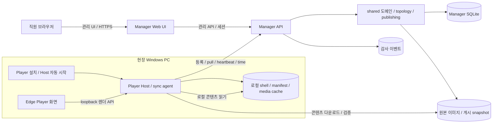
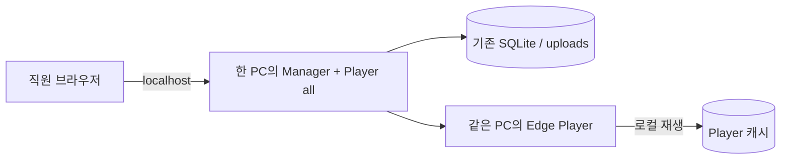
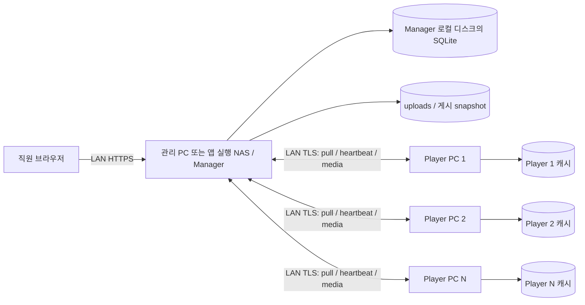
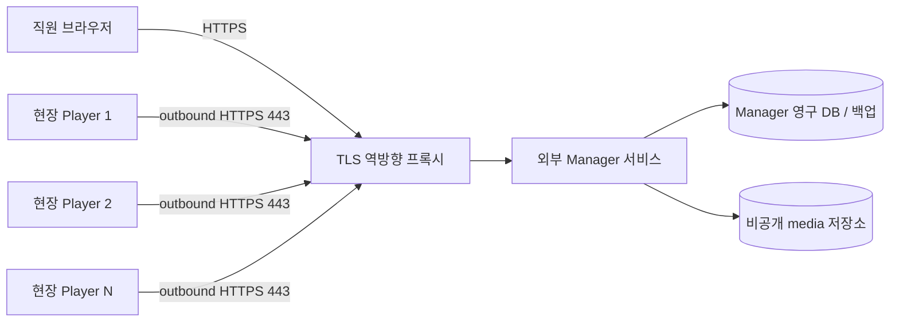

# Manager / Player 분리와 3가지 배포 모드

작성일: 2026-11-24

최종 갱신: 2026-11-25

기준: `main` `7d802e1606fb5c735563d49e2f7b382077d9eaae` (2026-11-25 현재 main). PR [#4](https://github.com/toxicyou25-afk/GugakSignage/pull/4), [#6](https://github.com/toxicyou25-afk/GugakSignage/pull/6), [#8](https://github.com/toxicyou25-afk/GugakSignage/pull/8), [#9](https://github.com/toxicyou25-afk/GugakSignage/pull/9), [#11](https://github.com/toxicyou25-afk/GugakSignage/pull/11)이 모두 병합됐고, PR [#12](https://github.com/toxicyou25-afk/GugakSignage/pull/12)는 문서·증거만 추가했다.

동작 확인 기준: `a9394436c0485a5500789aa2c7c2d3ec3c299cd3`. 런타임 코드는 `7d802e1`과 같다.

상태: 설계 문서. `현재 구현`은 위 기준 SHA에서 확인한 동작이고, `목표`는 아직 구현되지 않은 계약이다. PR 병합은 gate PASS를 뜻하지 않는다.

## 1. 목표와 범위

Manager는 직원이 브라우저만으로 이미지, 재생목록, 장소, 화면, 배치, 미리보기, 게시와 장비 상태를 관리하는 웹 애플리케이션이다. Player는 현장 Windows PC에 설치해 연결된 모니터에서 콘텐츠를 재생하고, 네트워크 단절에도 마지막 정상 게시물을 계속 표시하며, 복구 후 Manager에 상태를 보고하는 실행 환경이다.

한 코드베이스의 모듈 경계를 먼저 만든다. 첫 단계부터 서비스나 DB를 여러 개로 쪼개지 않는다. `shared` 도메인과 게시 manifest 계약을 고정하고 Manager API와 Player runtime을 분리한 다음, 설정만으로 다음 모드를 고른다.

1. **독립 실행**: 한 PC에서 Manager와 Player를 함께 실행한다. 기존 단일 설치와 데이터 경로를 유지한다.
2. **LAN 중앙관리**: 내부 PC 또는 애플리케이션을 실행할 수 있는 NAS 한 곳에서 Manager를 실행하고, 인터넷 없이 현장 Player 여러 대가 LAN으로 접속한다.
3. **외부 웹서버 중앙관리**: Manager를 외부 호스트에 두고 Player가 TLS를 사용해 WAN으로 접속한다. 이 단계에서는 배포 설계만 하며 외부 서버를 만들거나 공개하지 않는다.

직원용 관리자 클라이언트는 웹브라우저다. 현장 PC에는 Player 설치 프로그램과 자동 실행·복구 계층을 둔다. 모니터 수, 해상도, 방향, 배치와 디스플레이 식별자를 코드 상수로 고정하지 않는다.

### 목표가 아닌 항목

- 이번 문서 작업에서 코드, 설치 파일, 기존 PR 파일을 수정하거나 제품을 배포하지 않는다.
- 외부 호스팅 계정·DNS·TLS 인증서·방화벽을 설정하지 않는다.
- SQLite를 즉시 다른 DB로 교체하거나 마이크로서비스로 재작성하지 않는다.
- 지원하지 않는 모니터 인식 API, 브라우저 키오스크 정책 또는 iframe 동작을 이미 해결된 것으로 간주하지 않는다.

## 2. 설계 결정 요약

1. **Manager가 권위의 원천이다.** 이미지 원본, 구성, 화면 할당, 사용자·장비 상태, 감사 로그와 게시 버전을 Manager가 소유한다. Player는 게시된 읽기 전용 스냅샷만 적용한다.
2. **Player는 로컬 캐시를 가진다.** 설치형 Player runtime이 셸, 마지막 정상 manifest와 콘텐츠를 보관하고 재생한다. Manager 연결이 끊겨도 새 설정을 만들거나 기존 콘텐츠를 지우지 않는다.
3. **첫 배포는 모듈형 모놀리스다.** 기존 Node 24 / Express / SQLite를 재사용하고 런타임 역할에 따라 라우트와 로컬 기능을 조합한다. 별도 Manager/Player 프로세스 경계는 배포 검증 결과를 보고 정한다.
4. **기존 설치를 `all` 모드로 유지한다.** 기존 `.env`, DB, 업로드 경로, 브라우저 프로필과 설치본은 자동 이전하지 않고 그대로 읽는 호환 경로를 둔다.
5. **중앙 모드의 Player 트래픽은 암호화한다.** LAN도 TLS를 기본으로 설계하고, 외부 모드는 HTTPS와 역방향 프록시를 요구한다. loopback 독립 실행만 HTTP를 허용한다.

### 2.1 오너 결정 기록 (2026-11-25)

2026-11-25 오너가 확정한 5건이다. 아래 일반 설계 요약과 충돌하면 이 표를 우선한다.

| # | 결정 | 확정 내용 | 반영 위치 |
|---|---|---|---|
| 1 | 현장 모니터 식별·배치 | **C.** Player 로컬 Host가 Windows DisplayConfig/Win32를 권위 소스로 사용한다. WebView2/브라우저 `screen` API는 보조 검증·fallback으로만 사용한다. 두 소스가 불일치하면 OS/DisplayConfig를 우선하고 browser 값은 검증·경고에만 쓴다. Phase 1 spike에서 실제 장비 2대 이상을 재시작·재연결해 안정 ID를 확인하고, 실패하면 요구를 낮추지 않고 배치 모델을 재설계한다. | [§6 모니터 식별·배치](#모니터-식별배치-결정-1), [§12 Phase 1](#12-단계별-로드맵과-게이트) |
| 2 | Player Host/자격 증명 | **B.** 로그온 사용자 프로세스 + loopback HTTP + DPAPI CurrentUser를 사용한다. Phase 1은 서비스/무로그온 기동을 요구하지 않는다. 무로그온 기동이 필요해지면 Phase 2에서 A(Windows 서비스 + DPAPI LocalMachine)를 추가한다. C(Edge app 직접 실행 + 파일/URL token)는 token 노출 때문에 제외한다. | [§4 Player Host](#player-host-경계와-실행-방식-결정-2), [§12 Phase 1·2](#12-단계별-로드맵과-게이트) |
| 3 | LAN TLS | 기관 CA가 있으면 **B**(AD CS/내부 CA), 없으면 **A**(앱 자체 소규모 CA + 장비별 인증서)를 사용한다. 현재 환경은 기관 CA 확정 전이므로 **A를 기본값**으로 두고, 기관 CA가 제공되면 B로 전환한다. C(자체 서명 수동 배포)는 임시 조치로만 허용하고 D(LAN HTTP)는 금지한다. CA 개인키 보관·배포·갱신 책임과 기관 CA 전환 절차는 §8에 둔다. | [§8 LAN TLS](#lan-tls와-인증서-운영-결정-3), [§12 Phase 2](#12-단계별-로드맵과-게이트) |
| 4 | 외부 호스팅 | **A.** 1차에는 외부 인프라를 구축하지 않고 central은 설계만 유지한다. 데이터 위치·관리자 접근 정책·비용·백업/복구 담당자·보존 기간이 확정되기 전에는 외부에 데이터를 두지 않는다. | [§4 배포 모드 3](#배포-모드-3-외부-웹서버-중앙관리-설계), [§12 Phase 3](#12-단계별-로드맵과-게이트) |
| 5 | 첫 암호·등록 코드/token과 선행 gate | **B.** 설계·구현은 병행하되 LAN/central 배포는 PR #4/#6 PASS와 현장 검증 이후로 제한한다. `0000`은 격리 테스트 입력값으로만 허용하고 운영 첫 실행에서 변경을 강제한다. 관리자 암호 변경 전에는 외부·사내 네트워크 listen을 열지 않는다. 등록 코드는 1회용·단기 만료·실패 횟수 기록을 적용한다. 장비 token은 hash만 저장하고 회전·폐기 UI를 제공한다. | [§8 첫 암호와 token 정책](#첫-암호와-등록-코드-token-정책-결정-5), [§12 gate](#12-단계별-로드맵과-게이트) |

## 3. 기준 main의 현재 구조와 재사용 자산

아래는 `a9394436c0485a5500789aa2c7c2d3ec3c299cd3`에서 확인한 구조이며, 병합한 `main` `7d802e1`의 런타임 코드도 같다. PR #4/#6/#8/#9/#11은 `main`에 병합됐고, 이 문서의 `현재` 서술은 그 코드를 기준으로 한다. 설치·실행 로컬 검증은 [1차 마감 설치·실행 검증](../install/verification.md)에 있고, 실제 재부팅·물리 모니터·별도 PC LAN은 그 검증에서도 `NOT_RUN`이다.

| 영역 | 현재 자산과 책임 | 분리 설계에서의 재사용 / 주의점 |
|---|---|---|
| 서버 진입점 | [`src/server.ts`](../../src/server.ts), [`src/app.ts`](../../src/app.ts): Node 서버 시작, Express 라우트 구성, 정적 파일 제공. API·관리 화면·플레이어가 같은 origin에 있다. | 라우트 등록을 `manager`, `player`, `all` 역할 조합으로 나눈다. `all`은 기존 URL과 순서를 유지한다. |
| 설정 | [`src/config.ts`](../../src/config.ts), [`src/env.ts`](../../src/env.ts), [`.env.example`](../../.env.example): `DATA_DIR`, `DB_PATH`, `UPLOAD_DIR`, `ADMIN_PASSWORD`, `SESSION_SECRET` 등을 읽는다. | 새 `GUGAK_*` 변수에 기존 변수 별칭을 제공한다. 첫 실행 시 DB·업로드를 이동하거나 덮어쓰지 않는다. |
| SQLite | [`src/db.ts`](../../src/db.ts): `meta`, `sites`, `contents`, `playlists`, `playlist_items`, `layouts`, `devices`, `display_groups`, `displays`, `schedules`, `publications`; 외래 키, WAL, `busy_timeout`을 설정한다. | 초기에는 Manager DB 하나가 권위 데이터다. 한 Manager 프로세스만 DB를 쓰게 하고 DB 파일을 SMB/NFS 공유 폴더에 직접 두지 않는다. |
| 관리자 API | [`src/routes/contents.ts`](../../src/routes/contents.ts), [`src/routes/playlists.ts`](../../src/routes/playlists.ts), [`src/routes/devices.ts`](../../src/routes/devices.ts), [`src/routes/topology.ts`](../../src/routes/topology.ts), [`src/routes/dashboard.ts`](../../src/routes/dashboard.ts), [`src/routes/player-control.ts`](../../src/routes/player-control.ts), [`src/player-control.ts`](../../src/player-control.ts) | 인증된 브라우저 전용 경로로 유지한다. 현재 콘텐츠 등록·수정, 장비 연결/할당, 화면 그룹 구성, 미리보기, 게시와 재생기 실행·중지 기능을 역할 경계 안으로 옮긴다. 재생기 제어는 관리자 session과 loopback 제한을 함께 적용한다. |
| 게시 / topology | [`src/publishing.ts`](../../src/publishing.ts), [`src/topology.ts`](../../src/topology.ts), [`src/topology-migration.ts`](../../src/topology-migration.ts): 게시 시 snapshot을 `publications`에 저장하고 장비별 버전을 갱신한다. Site / DisplayGroup / Display / Layout 기반 구성과 화면별 PC 매핑을 제공한다. | snapshot을 Player의 배포 단위로 재사용한다. 게시 버전과 강한 ETag, 이전 버전 재시도, 콘텐츠 해시를 API 계약으로 명시한다. |
| 관리자 UI | [`public/admin/`](../../public/admin/): 브라우저에서 API를 호출하는 정적 관리자 화면. 로그인 후 대시보드가 기본 화면이고, 대시보드·기기 카드에서 `재생기 실행`과 `중지`를 제공한다. | 직원은 이 웹 화면만 사용한다. 별도 설치형 Manager 클라이언트를 요구하지 않는다. 재생기 제어는 관리자 화면에서만 노출한다. |
| Player UI | [`public/player/`](../../public/player/), [`public/player/player.js`](../../public/player/player.js): 코드 등록, manifest 적용, 이미지 출력, 시간 보정, heartbeat, 재생 상태와 화면 배치를 처리한다. 현재 device token은 브라우저 `localStorage`에 저장된다. | 렌더링·재생 규칙은 `shared` 계약을 소비하게 한다. 현재의 브라우저 token 저장은 [결정 2](#player-host-경계와-실행-방식-결정-2)의 Player Host + DPAPI로 대체할 목표다. |
| Service Worker | [`public/player/sw.js`](../../public/player/sw.js)는 same-origin `/player/`와 `/engine/`의 shell/engine 파일만 캐시한다. Player는 manifest를 localStorage에 기록하고 콘텐츠를 기본 fetch cache로 미리 가져온다. | 현재 `uploads` 콘텐츠는 Service Worker cache 경로가 아니다. browser HTTP cache에만 기대지 않도록 Player 소유의 durable media cache와 게시 version 보호를 추가한다. |
| Windows Edge 실행기 | [`start-player.cmd`](../../start-player.cmd)는 설치된 Edge app/fullscreen 또는 Chrome kiosk를 별도 프로필로 실행한다. 기본 URL은 localhost이고 `SIGNAGE_PLAYER_URL` 또는 인수로 바꿀 수 있다. 설치본의 일반 실행은 관리자 화면의 **재생기 실행** 버튼을 사용한다. 현재 Player 화면 자체는 `public/player`의 브라우저 앱이며 독립 native EXE는 아니다. | Edge의 kiosk 모드는 프로필 저장 공간을 지울 수 있어 실행기는 Edge에서 app/fullscreen 프로필을 사용한다. 이 동작을 설치 회귀 기준으로 둔다. |
| 설치 프로그램 | PR [#4](https://github.com/toxicyou25-afk/GugakSignage/pull/4)는 `main`에 병합됐다(`8e1661d`). `installer/GugakSignage.iss`, `installer/install.ps1`, `installer/set-autostart.ps1`, `installer/uninstall.ps1`, `installer/ops/install-common.ps1`이 있다. | 해당 파일은 이 설계 작업에서 수정하지 않는다. 병합된 설치 선택지에 Manager+Player와 Player only를 더하고 현재 single install 기본값을 유지한다. |
| watchdog / 복구 | PR #4 병합(`8e1661d`)의 `installer/ops/watchdog.mjs`, `installer/ops/watchdog-health.mjs`, `installer/verify-browser.mjs`가 health·CDP 기반 재생 감시, 재시작 제한, 수동 복구 점검을 제공한다. PR #11(`a939443`)이 로그온 시 관리자 페이지 자동 열기와 재생기 온디맨드 실행을 추가했다. 작업 스케줄러 등록은 `installer/set-autostart.ps1`에 있다. | 병합된 코드를 설치 검증과 함께 재사용한다. watchdog는 단순 프로세스 생존만 보지 않고 마지막 frame·현재 manifest version·브라우저 health를 함께 본다. 로그온·watchdog 시작만으로 재생기를 띄우지 않고 관리자 실행 요청을 받은 뒤에만 띄운다. |
| 첫 암호 변경 / 인증 | PR [#6](https://github.com/toxicyou25-afk/GugakSignage/pull/6)(`4a12df5`)과 [#8](https://github.com/toxicyou25-afk/GugakSignage/pull/8)(`966888e`)이 병합됐다. [`src/admin-password.ts`](../../src/admin-password.ts)는 scrypt hash와 `0000` 테스트 기본값 표시를 DB meta에 저장하고, 암호 변경 시 session epoch를 바꾼다. [`src/admin-access.ts`](../../src/admin-access.ts)는 테스트 기본값 동안 관리자 경로를 loopback으로 제한한다. [`src/auth.ts`](../../src/auth.ts)의 12시간 HMAC cookie는 HttpOnly/SameSite=Lax지만 `Secure`는 아직 false다. 로그인 시도 제한·CSRF 검증·감사 이벤트 테이블은 목표다. `.env.example`의 테스트 기본값은 `0000`이다. | 테스트용 `0000`은 격리된 테스트·첫 실행 검증 범위로만 한정한다. 운영 환경에서는 네트워크 접근 전에 고유 암호를 설정하게 하고 기본값으로 로그인할 수 없게 한다. 현재 `HOST` 기본값은 `0.0.0.0`이므로 [결정 5](#첫-암호와-등록-코드-token-정책-결정-5)의 listen 차단은 LAN 배포 전 추가 gate다. |

### 현재 구현: 관리자 기본 화면과 재생기 온디맨드 (#11)

기준 `a939443`에서 확인한 동작이다. 아래는 현재 구현이며, ETag·token hash·1회용 등록 코드·media ACL 같은 [API 목표 계약](manager-player-api.md#3-목표-계약-표)과 구분한다.

- `GET /`는 `/admin/`으로 redirect한다. 로그인 뒤 관리자 대시보드가 기본 화면이다.
- 로그온 예약 작업은 watchdog과 서버를 시작하고, watchdog은 서버 health가 준비되면 기본 브라우저로 `/admin/`을 최대 한 번 연다. 전체화면 재생기는 로그온이나 watchdog 시작만으로 실행하지 않는다.
- 관리자 대시보드와 기기 카드의 **재생기 실행** 버튼이 `POST /api/player/launch`를, **중지**가 `POST /api/player/stop`을 호출한다. 실행·중지 상태는 `GET /api/player/state`로 읽는다. 세 경로는 관리자 session이 필요하고, `0000` 테스트 기본값 동안 loopback으로 제한된다.
- 서버는 실행 요청을 `data/control/player-command.json`에 원자적으로 쓰고 `202`를 반환한다. 로컬 watchdog이 명령을 읽어 Edge 재생기를 `http://127.0.0.1:<port>/player/?code=<pairing_code>&reconnect=1`로 실행하고 `data/control/player-state.json`에 desired/running/PID/시작 시각/기기 정보를 기록한다. 관리자 UI는 최대 약 6초 동안 state를 polling한다.
- `POST /api/player/launch`는 `{ok, accepted, commandId, playerUrl, player}`를 반환한다. 빈 `deviceId`는 `400`, 없는 기기는 `404`다. 이 API는 실행 명령 접수까지만 보장하며 실제 Edge 기동은 watchdog 응답에 달려 있다.
- 재생기 창을 사용자가 닫으면 watchdog은 desired를 `stopped`로 바꾸고 자동 재실행하지 않는다. 비정상 종료만 마지막 desired가 `running`일 때 제한적으로 복구한다.
- `/api/dashboard`는 `playerControl`을 포함하고, 재생 중 `playing:<contentId>`와 현재 송출 항목을 맞춰 **지금 화면**을 강조한다.

이 동작은 [1차 마감 검증](../install/verification.md)에서 로그온 직후 재생기 미실행, 관리자 실행 버튼 뒤 기동, 중지, 서버 강제 종료 후 약 2.6초 health 복구로 로컬 확인됐다. 실제 재부팅·로그온, 물리 모니터, 별도 PC LAN, 24시간 soak, CI는 `NOT_RUN`이다.

### 기존 설계 문서

기존 문서의 내용을 복사하거나 덮어쓰지 않는다. 이 문서는 분리·배포 관점에서 다음 문서를 함께 읽도록 연결한다.

- [기존 애플리케이션 아키텍처](architecture.md)
- [동기화와 시계 보정](sync.md)
- [다중 모니터·topology](multimonitor.md)
- [현재 런타임과 설치 동작](mvp-runtime.md)
- [관리자 UI/UX](ui-ux.md)

## 4. 목표 컴포넌트

Manager와 Player 사이의 장비 등록, 게시 manifest, heartbeat, 미디어 다운로드 및 오류 재시도 계약은 [API 설계 문서](manager-player-api.md)를 참고한다.



Manager API는 관리용 CRUD와 Player용 API를 논리적으로 구분한다. Player Host는 장비 자격 증명과 로컬 저장소를 소유하며 브라우저 화면에는 bearer token을 전달하지 않는다. 초기 구현에서 Host와 현재 Player JS가 일부 같은 프로세스·origin을 공유해도 계약은 별도 경계로 둔다.

### 배포 모드 1: 독립 실행



설치 프로그램의 기본 호환 모드다. `GUGAK_ROLE=all`, `GUGAK_MODE=standalone`, `GUGAK_MANAGER_URL=http://127.0.0.1:<port>`로 기존 단일 서버와 Player를 함께 제공한다. 기존 DB, uploads, `.env`, 샘플 데이터 정책과 URL을 보존한다. #11 기준으로 로그온 뒤에는 관리자 페이지가 기본으로 열리고, Player 화면은 관리자 실행 요청 전에는 시작하지 않는다.

### 배포 모드 2: LAN 중앙관리



인터넷 연결 없이 내부 DNS 또는 고정 주소와 LAN 인증서를 사용한다. 각 Player는 Manager로 outbound 연결을 시작한다. NAS를 쓸 경우 앱과 SQLite를 NAS의 지원되는 로컬 persistent volume에서 실행한다. DB 파일을 여러 PC가 SMB/NFS로 공유하지 않는다.

### 배포 모드 3: 외부 웹서버 중앙관리 설계



이번 범위는 구성·보안·복구 조건을 설계하는 데 한정한다. 서버나 도메인을 생성하지 않는다. **결정 4(A)**에 따라 1차에는 외부 인프라를 구축하지 않고 central은 설계만 유지한다. 데이터 위치·관리자 접근 정책·비용·백업/복구 담당자·보존 기간이 확정되기 전에는 외부에 데이터를 두지 않는다. Player가 인터넷 단절 중 계속 재생하는 경로는 LAN 모드와 동일한 로컬 manifest·media cache다.

### Player Host 경계와 실행 방식 (결정 2)

Phase 1의 Player Host는 **B. 로그온 사용자 프로세스 + loopback HTTP + DPAPI CurrentUser**로 구현한다.

- Host는 각 현장 PC의 로그온 사용자 세션에서 실행되고 `127.0.0.1`에만 bind한다. Manager URL·device token·로컬 cache·monitor 관측을 소유하고, Edge/WebView2 renderer는 loopback API로 manifest·media·상태를 받는다.
- 장비 token은 사용자 프로필의 DPAPI `CurrentUser` 범위로 보호한다. 브라우저 `localStorage`, URL, 명령행 인수, 로그에는 device token 원문을 두지 않는다.
- Phase 1은 Windows 서비스나 무로그온 기동을 요구하지 않는다. 로그온 시 watchdog이 Host를 시작하고, 재생기 화면은 관리자의 **재생기 실행** 요청이 있을 때만 시작한다.
- 무로그온 기동이 제품 요구가 되면 Phase 2에서 **A. Windows 서비스 + DPAPI LocalMachine**을 추가한다. 서비스 계정, machine 범위 비밀, 세션 0의 renderer 제약, 설치·업데이트·권한 상승을 별도 설계·검증한다. B를 기본값으로 유지하고 A 추가가 B의 동작을 바꾸지 않게 한다.
- **C. Edge app 직접 실행 + 파일/URL token**은 제외한다. token이 브라우저 저장소·URL·프로필·로그에 노출될 수 있고 회전·폐기를 Host 경계에서 강제할 수 없다.

현재 `a939443`에는 별도 Player Host가 없다. Node 서버와 `public/player`가 같은 origin을 쓰고, Player JS가 device token을 `localStorage`에 보관한다. #11의 실행/중지 제어는 watchdog의 로컬 command/state 파일을 매개로 한다. 따라서 위 Host 경계와 DPAPI 저장은 Phase 1 목표이며, 현재 구현을 Host가 이미 분리됐다는 뜻으로 읽지 않는다.

## 5. Manager와 Player의 데이터 소유권

| 데이터 | 권위 / 저장 위치 | Player 연결 끊김 시 동작 |
|---|---|---|
| 이미지 원본, checksum, 콘텐츠 메타데이터 | Manager `contents`와 uploads | 로컬 복사본은 캐시일 뿐이며 Manager가 게시를 취소해도 마지막 정상 manifest가 참조하는 파일은 오프라인 재생이 가능하도록 보존한다. |
| 재생목록·시간표 | Manager `playlists`, `playlist_items`, `schedules` | Player는 게시 snapshot에 들어 있는 읽기 전용 복사본으로 재생한다. |
| 장소·그룹·디스플레이·화면 배치·PC 할당 | Manager topology 테이블과 게시 snapshot | Player가 관측한 모니터는 보고 데이터다. 이름·논리 display ID·배치 할당의 권위는 Manager에 있다. |
| 게시 버전·manifest·게시자·시각 | Manager `publications`; 향후 감사 이벤트 | Player는 마지막으로 검증해 원자적으로 활성화한 버전을 유지하고, 오래된 버전으로 자동 되돌리지 않는다. |
| 관리자 계정·역할·세션·감사 로그 | Manager | Player에 저장하지 않는다. |
| 장비 등록 상태·token 해시·폐기 시각·마지막 접속 | Manager `devices` 및 향후 장비 자격 증명 저장소 | 유효 token 원문은 Player 전용 비밀 저장소에 한 번만 둔다. 재등록은 Manager의 명시적 승인 흐름이다. |
| Manager URL, device ID, token, Player 설정 | Player `GUGAK_DATA_DIR`의 보호된 설정/자격 증명 저장소 | 해당 장비만 복구한다. Manager 원본 DB의 대체물이 아니다. |
| manifest 캐시·콘텐츠 캐시·shell | Player 로컬 앱 데이터 디렉터리. Service Worker 캐시는 보조 복사본 | 네트워크 없이 재생한다. 캐시가 손상되면 checksum 검증 후 다시 내려받는다. 백업 복원 대상은 아니다. |
| 로컬 로그와 장애 보고 큐 | Player 로컬 회전 로그 및 전송 대기열 | 연결 복구 후 비밀값 제거된 상태 이벤트만 재전송한다. 용량 상한을 두고 오래된 로그를 회전한다. |

게시 적용은 `다운로드 → 길이/checksum 검증 → staging 디렉터리 → 원자적 활성화 → 이전 버전 보존` 순서다. 새 manifest 또는 asset이 불완전하면 현재 활성 버전을 바꾸지 않는다.

## 6. 역할·모드·설정

```dotenv
GUGAK_ROLE=all                 # manager | player | all
GUGAK_MODE=standalone          # standalone | lan | central
GUGAK_MANAGER_URL=http://127.0.0.1:3000
GUGAK_DEVICE_TOKEN=            # player 전용; 운영에서는 비밀 저장소 사용
GUGAK_DATA_DIR=./data          # 역할별 데이터 디렉터리의 기준
```

| 모드 | Manager 역할 | Player 역할 | 예상 URL / 위치 |
|---|---|---|---|
| `standalone` | 같은 실행기에서 활성 | 같은 PC에서 활성 | localhost. 기존 설치 기본값은 `all`과 동일 동작. |
| `lan` | 한 PC/NAS에서 활성 | 현장 PC마다 별도 설치 | 내부 DNS 이름의 HTTPS Manager URL. 인터넷은 필요하지 않음. |
| `central` | 외부 호스트에 활성 | 현장 PC마다 별도 설치 | 고정 HTTPS 공개 주소. 이번 작업에서 외부 인프라는 만들지 않음. |

역할 검증은 조합 오류를 시작 단계에서 알린다. `role=player`에 token/Manager URL이 없으면 등록 대기 화면만 보여 주고 Manager API에 접근하지 않는다. `role=manager`는 화면 자동 실행이나 디스플레이 출력을 시작하지 않는다. `role=all`은 독립 실행 모드에서 기존의 관리·재생 URL을 모두 제공한다.

기존 `DATA_DIR`, `DB_PATH`, `UPLOAD_DIR`, `PORT`, `HOST`, `ADMIN_PASSWORD`, `SESSION_SECRET`은 하위 호환 별칭으로 읽는다. 예시 우선순위는 `GUGAK_DATA_DIR` → 기존 `DATA_DIR` → 기존 기본 경로다. 기존 설치를 처음 여는 마이그레이션은 시작 전 백업을 요구하고, 데이터 이동은 자동으로 하지 않는다.

### 모니터 식별·배치 (결정 1)

현장 모니터 식별과 배치는 **C. Windows DisplayConfig/Win32를 권위 소스로 Player 로컬 Host에서 사용**하는 방식으로 확정한다.

- Host는 Windows DisplayConfig/Win32 API로 연결된 monitor의 device path·target ID·bounds·rotation·refresh rate를 수집한다. 이 값이 실제 물리 모니터와 배치의 권위 소스다.
- WebView2/브라우저 `window.screen` API는 보조 검증과 fallback으로만 사용한다. 두 소스가 불일치하면 OS/DisplayConfig 값을 우선하고, browser 값은 검증·경고에만 쓴다.
- Manager에는 발견값과 운영자가 승인한 논리 배치를 별도로 표시한다. 이름·논리 display ID·화면 할당의 권위는 Manager에 있고, Player는 관측값을 보고한다.
- 화면 수, 해상도, 방향, 배치, 회전, 해상도별 기본값을 코드 상수나 설치 유형별 분기로 고정하지 않는다.
- **Phase 1 spike gate:** 실제 장비 2대 이상에서 재시작·연결 해제·재연결을 반복한 뒤에도 같은 물리 monitor에 안정적인 ID가 유지되는지 확인한다. 실패하면 요구를 browser API 수준으로 낮추지 않고 배치 모델을 재설계한다.

현재 `a939443`은 Player JS가 `window.screen` 크기와 URL의 `display` 파라미터를 보고하는 수준이며, 물리 monitor 배열·식별을 OS에서 열거하지 않는다. 위 결정은 Phase 1 목표이고, 현재 구현이 안정 ID를 이미 제공한다는 뜻이 아니다.

## 7. 점진적 경계 추출

1. **기존 동작 고정**: `a939443` 기준 `main`에서 PR #4/#6/#8/#9/#11 병합 후의 단일 설치 동작(관리, 등록, 게시, 재생, 업데이트, 오프라인 재생, 관리자 기본 화면, 재생기 온디맨드 실행)을 기록한다.
2. **shared 경계**: 현재 타입과 순수 계산을 `shared` 도메인(예: manifest schema/version, topology, playback, media descriptor)으로 이동한다. DB·HTTP·DOM·Windows API 의존성은 두지 않는다. API/렌더러는 같은 형식 계약을 쓴다.
3. **Manager route 경계**: `/api/auth`, `/api/dashboard`, `/api/contents`, `/api/playlists`, `/api/devices`, topology와 publish의 등록 코드를 `manager` 조립 모듈에서 묶는다. Manager DB와 파일 저장소의 소유자는 한 곳이다.
4. **Player runtime 경계**: 등록/manifest pull/time/heartbeat, 로컬 캐시, renderer와 Windows launcher/watchdog를 `player` 조립 모듈에 둔다. 초기에는 Node/Express 및 `public/player`를 재사용한다. 별도 로컬 Host가 필요하면 Player가 loopback에만 바인딩해 Edge shell과 동기화를 중개한다.
5. **설정 조립**: `GUGAK_ROLE`과 `GUGAK_MODE`로 컴포넌트와 URL을 선택한다. 같은 acceptance set을 `all`, `manager`, `player`에서 실행한다. 분리 단계마다 기존 DB를 같은 매핑으로 읽는다.
6. **배포 확대**: 독립 실행 회귀가 통과한 뒤 LAN을 검증하고, 그 결과로 central의 TLS, 권한, 데이터 내구성 요구를 확정한다.

기존 route를 새 경계로 옮기는 동안 endpoint 계약과 콘텐츠 출력은 유지한다. 관리자가 만든 임시 변경을 Player가 읽지 않게 하고, 게시 버튼이 성공한 시점에 생성한 immutable snapshot만 전달한다.

### 설치 프로그램 역할 선택

- **Manager + Player**: 현재 설치본과 동등한 `all / standalone` 설치. 기존 사용자의 기본 선택과 기존 바로가기·데이터 경로를 보존한다.
- **Player only**: Windows Player runtime, Edge 실행기, 장비 등록 안내, watchdog와 로컬 cache만 설치한다. 관리자 DB·관리자 비밀번호·샘플 Manager를 만들지 않는다.
- (선택 구현) **Manager only**: Manager 호스트용 설치 옵션은 LAN 단계에서 제공한다. NAS 컨테이너 방식은 지원 OS와 볼륨 운영이 확인된 뒤 별도 패키징을 결정한다.

Player only 설치에 성공하려면 Manager URL·장비 등록 방법·오프라인 시 재생 여부가 확인 가능해야 한다. 버전 업그레이드는 Manager shell과 Player 설치 payload의 호환 버전을 확인하고, 실패 시 이전 shell/cache 및 설치 파일로 되돌린다.

## 8. 보안 설계

### 관리자 경로

현재 `a939443`은 scrypt 암호 hash, `0000` 테스트 기본값 표시, 기본값 경고, 테스트 기본값 동안 관리자 경로 loopback 제한을 구현했다. `HOST` 기본값은 `0.0.0.0`이고 cookie `Secure`는 false이며, 시도 제한·CSRF·감사 이벤트는 아직 목표다.

- 관리자 API는 역할과 권한을 검사하고, 관리자 session cookie는 TLS에서 `Secure`, `HttpOnly`, `SameSite`를 사용한다. 세션 만료·로그아웃·암호 변경 시 세션을 무효화한다.
- 상태 변경 요청은 CSRF token과 `Origin`/`Referer` 검증을 함께 적용한다. 현재 same-origin 쿠키 동작만으로 LAN/central 보안을 완성했다고 보지 않는다.
- 로그인 실패는 계정과 원격 주소별로 제한하고 재시도 지연 및 감사 이벤트를 기록한다. 계정 잠금만으로 서비스 거부가 가능해지지 않게 설계한다.
- 업로드·게시·배치 변경·등록 코드 재발급·기기 해제·역할 변경은 actor, 시각, 대상, 이전/새 버전, 결과를 감사한다. 비밀번호·세션·등록 코드·token 원문은 로그에 남기지 않는다.
- 개발·통합 테스트에서만 `0000`을 사용할 수 있다. 공개/중앙관리 배포는 첫 관리자 설정에서 고유 암호를 정하기 전 외부/사내 네트워크 listen을 금지한다. 운영 `.env`의 기본 암호와 고정 session secret을 허용하지 않는다.

### Player 자격 증명

- 짧은 수명의 1회성 등록 코드로 장비를 연결하고 Manager는 코드의 사용·만료·실패 횟수를 기록한다. 장비별로 scope가 제한된 token을 발급한다.
- DB에는 token hash와 생성/회전/폐기 시각을 저장한다. Manager 관리자 UI에서 폐기와 회전을 제공한다. 재등록, 인수(takeover), 분실·도난, 계정 복구는 이전 token을 즉시 무효화한다.
- token 원문은 Windows DPAPI/자격 증명 관리자 또는 ACL이 제한된 Player 데이터 파일에 저장한다. 명령행 인수, 브라우저 URL, 로그, 오류 메시지, git 파일과 기본 설정에 넣지 않는다. `GUGAK_DEVICE_TOKEN`은 자동화 테스트·일회성 배포에서만 사용하고 프로세스 환경 조회 권한을 제한한다.
- Player는 필요한 media, manifest, heartbeat, time만 호출한다. Manager 관리 API와 SQLite에 접근할 자격 증명을 받지 않는다.

### 첫 암호와 등록 코드 token 정책 (결정 5)

설계와 구현은 병행할 수 있지만, LAN/central 배포는 아래 gate를 통과한 뒤에만 한다.

- `0000`은 격리 테스트와 첫 실행 검증의 입력값으로만 허용한다. 운영 첫 실행에서는 관리자 암호 변경을 강제하고, 변경 전에는 외부·사내 네트워크 listen을 열지 않는다. 현재 구현은 경고 배너와 관리자 경로 loopback 제한까지이며, listen 차단과 변경 강제는 LAN 배포 전 목표다.
- 관리자 암호 변경 전에는 Manager/Player의 외부·사내 네트워크 listen을 열지 않는다. standalone은 loopback만 bind하고, Phase 2 LAN은 암호 변경 완료 후에만 네트워크 bind를 허용한다.
- 등록 코드는 1회용이며 짧은 만료를 둔다. 사용·만료·실패 횟수를 기록하고, 재발급과 실패 잠금 해제는 관리자 session으로만 수행한다.
- 장비 token 원문은 발급 시 한 번만 표시하고 DB에는 hash와 생성·회전·폐기 시각만 저장한다. 관리자 UI에서 회전·폐기를 제공하고, 회전·재등록·분실·도난 시 이전 token을 즉시 무효화한다.
- **LAN/central 배포 gate:** PR #4/#6 PASS와 현장 검증을 모두 통과해야 한다. 두 PR의 병합만으로 gate를 열지 않는다. [1차 마감 검증](../install/verification.md)은 로컬 설치·실행·복구 증거이며, 실제 재부팅·로그온, 별도 PC LAN, 물리 모니터, 24시간 soak, CI는 `NOT_RUN`이다. 실제 암호 변경 후 LAN 전환도 `NOT_RUN`이다.

### 네트워크

- `standalone` loopback은 HTTP를 허용한다. LAN·central은 TLS를 사용한다. 아래 결정 3에 따라 기관 CA가 없으면 A, 있으면 B를 적용하고, C는 임시 조치, D(LAN HTTP)는 금지한다.
- 중앙관리 Player는 outbound HTTPS만 필요하도록 한다. Manager의 firewall은 관리자 웹과 API/media 포트만 허용하고 DB·파일 시스템 포트를 외부에 공개하지 않는다.
- 외부 모드의 TLS 역방향 프록시는 원래 scheme/host를 앱에 안전하게 전달하고, 허용 host, 업로드 한도, body/timeouts, 연결 수를 설정한다. HTTP로의 downgrade나 임의의 `X-Forwarded-*` 신뢰는 허용하지 않는다.
- 현재 전역 `X-Frame-Options: SAMEORIGIN`은 외부 URL wall 콘텐츠와 충돌할 수 있다. 허용 목록, CSP `frame-src`/`frame-ancestors`, 타 도메인 인증·차단 정책은 별도 결정한다. 임의 URL을 iframe으로 신뢰하지 않는다.

### LAN TLS와 인증서 운영 (결정 3)

- **선택 규칙:** 기관 CA가 있으면 **B(AD CS/내부 CA)**, 없으면 **A(앱 자체 소규모 CA + 장비별 인증서)**를 사용한다. 현재 환경은 기관 CA 확정 전이므로 A를 기본값으로 두고, 기관 CA가 제공되면 B로 전환한다. **C(자체 서명 수동 배포)**는 임시 조치로만 허용하고 **D(LAN HTTP)**는 금지한다.
- **A 책임:** 자체 CA 개인키는 오프라인 또는 ACL로 제한된 저장소에 두고, 발급·폐기 대장과 담당자를 지정한다. 장비별 인증서와 개인키는 DPAPI/ACL로 보호하고 설치·등록 시 배포하며, 만료 전 갱신과 장비 폐기 시 폐기를 수행한다. CA 개인키 유출 시 전체 장비 인증서를 재발급한다.
- **B 책임:** 기관 PKI/AD CS 운영자가 template·자동 등록·CRL/OCSP·갱신을 소유한다. 앱은 발급 결과와 인증서 주체-장비 ID 매핑을 검증하고, 만료·폐기 상태를 장비 상태에 반영한다.
- **A→B 전환 절차:** 장비·인증서 인벤토리 → AD CS template/정책 확정 → 신규 인증서 발급·신뢰 체인 배포 → 양쪽 신뢰 기간 운영 → Manager endpoint 전환·검증 → 자체 CA 키·인증서 폐기. 전환 중에도 HTTP fallback을 열지 않는다.
- 현재 `a939443`에는 TLS listener와 인증서 처리가 없다. `HOST=0.0.0.0`의 HTTP 서버이며 LAN TLS는 목표다. LAN 배포 전 TLS 종료, 인증서 검증, 만료·갱신 리허설을 실제 장비에서 확인한다.

## 9. 데이터 백업과 복구

### Manager

- 백업 단위는 SQLite DB와 WAL checkpoint 상태, uploads 원본, 게시 snapshot, 앱 버전·설정을 함께 포함한다. 파일만 따로 복사해 서로 다른 시점의 DB와 media가 섞이지 않게 한다.
- 제안 기본 주기: 매일 1회 백업, 최근 14일 보관, 주 1회 별도 매체 또는 별도 계정에 암호화 복사. 기관 보존 정책에 맞춰 기간·시간을 조정한다.
- 실행 중 SQLite 파일은 임의 복사하지 않는다. SQLite online backup API 또는 일관된 checkpoint/정지 절차를 사용한다. 백업 manifest에 DB integrity 결과, 파일 수/크기/hash, 생성 시각과 앱 버전을 기록한다.
- 복원은 별도 경로로 복사 → `PRAGMA integrity_check` → DB와 uploads 해시 확인 → 서비스 시작 → 관리자 UI/게시 manifest 확인 순서로 한다. 운영 데이터를 덮기 전에 현행 사본과 복구 승인 지점을 남긴다.
- 월 1회 격리 위치에 복원 훈련을 하고, 최근 백업 성공과 복원 시간(RTO)·복구 시점(RPO)을 기록한다.

### Player

Player cache는 복구 대상이 아니다. 설치 후 새 Manager URL/token으로 등록하고 현재 publication과 필요한 media를 다시 pull하면 재생 상태를 복구할 수 있어야 한다. 로컬 token은 Manager DB 백업의 일부가 아니며 PC 이미지·백업 유출 시 해당 장비 token을 폐기한다.

## 10. 오프라인 동작과 장애 복구

| 장애 | Player 동작 | Manager에 보일 상태 / 복구 |
|---|---|---|
| Manager 또는 네트워크 단절 | 새 pull은 실패하지만 마지막 checksum 검증 manifest와 media를 계속 재생한다. 대기 중인 오류 상태를 로컬에 기록한다. | heartbeat timeout 이후 `offline` 및 마지막 성공 시각을 표시한다. 재연결 시 현재 version·상태·누적 오류를 보내고 최신 publication을 비교한다. |
| 새 manifest/asset 일부 손상 | staging만 폐기하고 직전 정상 활성 snapshot을 유지한다. 오류와 hash를 보고하고 재시도한다. | 응답 5xx/429의 retry 지침을 따르며 동일 hash를 다시 검증한다. 임시로 빈 콘텐츠나 부분 publication으로 전환하지 않는다. |
| Edge/Player 화면 종료 | watchdog가 local health와 실제 재생 상태를 확인한 후 제한된 횟수로 Player를 재실행한다. | 재시작 원인·횟수·마지막 프레임을 보고한다. 반복 실패 시 재시작 폭주를 멈추고 현장 안내 상태로 남는다. |
| Windows 재부팅 | 작업 스케줄러가 지정 계정과 프로필로 Host/watchdog을 시작하고 관리자 페이지를 연다. Player 화면은 관리자 실행 요청 전에는 시작하지 않는다. | 등록 token과 cache가 보존되고 Manager 연결 시 자동 보고한다. Edge kiosk 업데이트 후에는 실제 프로필 유지 여부를 확인한다. |
| Service Worker 업데이트 실패 | 실행 중 shell과 마지막 정상 재생을 보존한다. 새 cache가 완전히 설치되기 전 현재 cache를 지우지 않는다. | update 실패·cache 공간 부족을 상태에 기록한다. watchdog의 health 검사에 재생 가능한 버전 정보를 포함한다. |
| 저장 공간 부족/유효 cache 삭제 | 현재 활성 버전과 manifest를 먼저 보호하고, 사용하지 않는 오래된 cache부터 정리한다. | Manager에 cache capacity, 마지막 다운로드 결과, 코드 오류를 보고하고 현장 확인을 알린다. |

현재 구현의 manifest·시간 응답·heartbeat 간격은 15초 설정을 사용하고, 장비 온라인 판정 기본값은 약 45초다. 목표안에서는 manifest pull과 상태 보고를 각각 기본 15초, 장비별 무작위 jitter ±3초로 분산한다. 네트워크 단절 중에는 15초 간격의 가벼운 재연결 probe로 상태를 확인하고, media/manifest 실패 재시도는 지수 backoff와 jitter로 5초에서 최대 5분 사이로 제한한다. 연결이 회복되면 상태 보고를 재개하고 1분 내 Manager 상태를 갱신하는 것을 목표로 한다. 이 목표는 LAN·WAN 실측으로 조정한다.

## 11. 성능 목표와 측정

다음은 현장 대표 PC 사양을 수집하기 전의 검증 가능한 초기 목표다. 영상은 대상이 아니며 정적 이미지 Player를 기준으로 한다.

| 항목 | 초기 목표 | 측정 조건 / 방법 |
|---|---|---|
| Manager 콘텐츠 목록 | 100장 등록 상태에서 첫 사용 가능한 목록 p95 ≤ 2.0초 | 대표 Manager PC, 1GbE LAN, 30회 반복. 목록 응답과 썸네일을 분리 측정하고 이미지 원본 전체를 동기 다운로드하지 않는다. |
| 8화면 topology 미리보기 | 미리보기 요청부터 결과 표시 p95 ≤ 2.0초 | 8 display, 100 asset, 현재 게시·배치 snapshot을 고정한 fixture. 서버 처리와 브라우저 렌더 시간을 각각 기록한다. |
| Player 시작 / 첫 프레임 | 캐시가 준비된 재시작 후 shell ready ≤ 5초, 첫 정상 frame ≤ 10초; 신규 다운로드 조건은 첫 frame ≤ 30초 | Windows 재부팅 10회 및 cold/warm cache 각각 실행. 시작 시각, loopback readiness, manifest 적용, frame 표시 이벤트를 기록한다. 신규 다운로드 시험 데이터는 100장 총 ≤250 MiB로 고정한다. |
| 전환 공백 | 정상 LAN에서 이미지 전환 시 검은 화면/빈 프레임 p95 ≤ 100ms | 같은 PC에서 8화면 시험. 각 이미지 전환을 화면 녹화/프레임 관찰로 30회 측정한다. 사전 로딩한 다음 이미지를 사용한다. |
| 시각 동기 | NTP가 정상인 유선 LAN에서 8화면의 동일 schedule 전환 편차 p95 ≤ 500ms | 30분 동시 실행 후 화면별 frame 시각을 고속 촬영 또는 원격 디버깅 이벤트로 비교한다. Wi-Fi/WAN 결과는 별도 수치로 기록한다. |
| 메모리 / 장기 안정성 | 8×1920×1080 정적 화면 기준 Edge + Player Host 합산 working set p95 ≤ 1.5 GiB, 24시간 중 증가율 ≤ 10% | 10분 warm-up 후 Windows Performance Monitor로 5회 측정. 프로세스 트리 전체를 집계하고 브라우저 disk cache/OS file cache는 별도 기록한다. 실제 사양 미달 시 4K/video 등 프로파일을 분리해 재협의한다. |

측정 결과는 개발 PC의 단일 수치만 기록하지 않는다. 장비 모델, Windows/Edge 버전, CPU/RAM/GPU, 화면 해상도, LAN/Wi-Fi RTT, cache 상태, 이미지 크기, 반복 횟수, p50/p95/최대값, 실패 수를 함께 남긴다. 목표 미달은 우선 DB query/썸네일 크기/렌더링과 cache 전략으로 진단하고, 수치만 낮추기 위해 해상도나 화면 수를 코드에 고정하지 않는다.

## 12. 단계별 로드맵과 게이트

2026-11-25 결정 5건을 반영한 로드맵이다. `Phase 0`은 `a939443`에서 확인한 현재 상태이고 이후 단계는 목표다. PR 병합, 로컬 검증, CI, 관리자 수동 수용, 현장 승인은 각각 별도 gate다.

| 단계 | 범위 / 산출물 | 수용 검증 | 중단 / 롤백 조건 |
|---|---|---|---|
| **Phase 0 — 현재 기준선 (완료된 병합)** | PR #4 설치·watchdog(`8e1661d`), #6 첫 암호 변경(`4a12df5`), #8 `0000` 로컬 전용·LAN 전환(`966888e`), #9 역중첩 경로 차단(`9fa9a45`), #11 관리자 기본 실행·재생기 온디맨드(`a939443`) 병합. #5 URL wall·화면 PC 매핑(`d30b301`), #1 MVP(`cfc8e73`), #12 1차 마감 검증(`7d802e1`) 후속. 기준 설치본, 기존 데이터 백업·복원 절차. | `a939443` 설치 검증에서 `npm test` 51/51 PASS, installer `test-guards` PASS, Inno build·업그레이드·데이터 보존 PASS, `/api/health` 200, watchdog 서버 강제 종료 후 약 2.6초 복구, 로그온 직후 재생기 미실행·관리자 실행 버튼으로만 기동·중지 PASS, `0000` 상태 LAN 관리자 403. `test-install`·`test-inno` PASS는 #11 검증(기준 `966888e` + 변경) 결과이며 `a939443`에서 재실행한 값이 아니다. `NOT_RUN`: 실제 재부팅·로그온, 물리 모니터, 별도 PC LAN, 24시간 soak, CI, 방화벽. | DB·uploads·Edge profile 손실, `0000`가 운영에 남음, 설치·복구 실패 시 역할 분리 작업을 시작하지 않는다. 이전 설치 파일과 백업으로 복구한다. |
| **Phase 1 — standalone + Player Host** | 기존 `all/standalone` 유지. shared/manager/player 모듈 경계, `GUGAK_ROLE`·`GUGAK_MODE`·환경 변수 호환, installer의 Manager+Player/Player only 선택 초안. **결정 2 B**: 로그온 사용자 프로세스 + loopback HTTP + DPAPI CurrentUser, 관리자 실행 시에만 renderer 시작. **결정 1 C**: Windows DisplayConfig/Win32 권위, browser API 보조. 실제 장비 2대 이상 재시작·재연결 spike. #11 관리자 기본 화면·재생기 온디맨드 유지. | 기존 API/UI/manifest/재생 시나리오와 데이터 디렉터리가 동일하게 동작한다. `all`과 독립 Manager/Player 경계를 설정만으로 선택한다. Host 밖 browser·URL·로그에 device token 원문이 없다. 실제 장비 2대 이상에서 재시작·재연결 후 안정 ID가 유지되고, 두 소스 불일치 시 OS 값 우선·browser 경고만 적용된다. | 안정 ID 검증 실패 시 browser-only로 요구를 낮추지 않고 배치 모델을 재설계한다. token 노출, 기존 URL wall·화면 PC mapping 결과 변경, 두 역할의 DB 경쟁 수정이 있으면 Host 분리를 되돌리고 `all`을 유지한다. |
| **Phase 2 — LAN 중앙관리** | LAN Manager 배포, Player only 설치, 장비별 token hash·회전·폐기 UI, 1회용·단기 만료 등록 코드와 실패 횟수 기록, pull/heartbeat/media, TLS **A 기본/B 기관 CA**, 무로그온 요구가 생기면 A(Windows 서비스 + DPAPI LocalMachine) 추가, 설치·운영 runbook. | **PR #4/#6 PASS + 현장 검증**을 모두 통과한다. 관리자 암호 변경 전 네트워크 listen을 열지 않고, 변경 후에만 LAN bind한다. TLS 인증서 검증·갱신·폐기를 확인한다. 인터넷 차단 LAN에서 2대 이상 Player 등록·게시·오프라인 재생·재연결·회전·폐기, Manager 재시작 중 기존 콘텐츠 지속, LAN 성능 목표를 확인한다. | token 평문·HTTP·`0000` 운영 잔존, Manager가 offline 중 전체 재생 정지, snapshot 손상, 인증서 검증 실패, LAN 성능 미달이면 현장 파일럿을 중단하고 standalone으로 복귀한다. |
| **Phase 3 — central 설계 only** | TLS 역프록시 요구사항, 공개 URL·비밀 관리, 업로드/media 정책, 배포·복구 runbook, WAN 실패 모델. **결정 4 A**에 따라 외부 인프라를 만들지 않는다. | 설계 review·tabletop만 수행한다. 데이터 위치·관리자 접근 정책·비용·백업/복구 담당자·보존 기간이 확정되기 전에는 외부에 데이터를 두지 않는다. 외부 서버·도메인·DNS·인증서를 실제로 만들지 않는다. | 위 조건이 확정되지 않으면 운영 배포를 보류한다. LAN/standalone은 계속 지원한다. |
| **Phase 4 — 보안·백업·UX·성능과 현장 soak** | 관리자 역할·CSRF·시도 제한·감사 로그, token lifecycle, DB/media 백업 자동화, 복원 훈련, 직원용 흐름, 성능 계측 dashboard, 실제 장비 설치 패키지·승인 topology·운영/장애 runbook. | 공격·오류 시나리오, 복원 훈련, 100장/8화면 2초 목표, static image 24시간 안정성, 실제 재부팅·로그온, 물리 모니터·유선/Wi-Fi·LAN 차단·Manager 재시작·Edge 업데이트·24시간 재생을 대표 장비에서 확인한다. 8화면과 실제 해상도·방향을 기록한다. | 기본 비밀번호나 token 원문이 남거나, backup 복원이 실패하거나, 성능 목표 근거가 재현 불가능하거나, 현장 화면 식별 오류·화면 비움·watchdog 반복 재시작·잘못된 화면 mapping 중 하나라도 있으면 출시 gate를 열지 않고 설치 전 상태로 rollback한다. |

**LAN/central 배포 gate:** 결정 5에 따라 PR #4/#6 PASS와 현장 검증을 모두 요구한다. 두 PR의 병합은 gate PASS가 아니다. [#12의 로컬 증거](../install/verification.md)는 설치·실행·복구에 유효하지만 실제 재부팅·로그온, 별도 물리 PC LAN, 물리 모니터, 24시간 soak, CI가 `NOT_RUN`이므로 LAN/central gate는 아직 열리지 않았다.

## 13. 위험과 미결정 사항

### 결정됨 (2026-11-25)

| 항목 | 결정 | 상태 |
|---|---|---|
| 현장 모니터 식별·배치 | C. Windows DisplayConfig/Win32 권위, browser API 보조, 불일치 시 OS 우선. | 결정됨 — Phase 1 실제 장비 2대 이상 spike 검증 대기 |
| Player Host/자격 증명 | B. 로그온 사용자 프로세스 + loopback HTTP + DPAPI CurrentUser. Phase 2에서 필요 시 A(서비스 + DPAPI LocalMachine) 추가. | 결정됨 — Phase 1 구현 |
| LAN TLS | 기관 CA 없으면 A(자체 CA), 있으면 B(AD CS/내부 CA). C는 임시, D(LAN HTTP) 금지. | 결정됨 — Phase 2 구현 |
| 외부 호스팅 | A. 1차 미구축, central 설계 only. 데이터 위치·접근·비용·백업 담당자·보존 기간 확정 전 외부 데이터 금지. | 결정됨 |
| 첫 암호·등록 코드/token·gate | B. `0000`은 격리 테스트만, 첫 실행 변경 강제, listen 차단, 1회용 코드, token hash·회전·폐기. LAN/central은 #4/#6 PASS + 현장 검증. | 결정됨 — Phase 2 gate |

### 남은 미결정

| 항목 | 현재 확인된 점 | 결정이 필요한 점 / 진행 전 증거 |
|---|---|---|
| 외부 호스팅 세부 | 결정 4로 1차 미구축은 확정됐다. 현재 API·asset은 same-origin 중심이고 외부 인프라는 없다. | 데이터 위치·관리자 접근 정책·비용·백업/복구 담당자·보존 기간을 확정한다. 확정 전에는 외부에 데이터를 두지 않는다. |
| DB 전환 | 현재 SQLite WAL과 한 Manager의 로컬 저장소가 기준이다. | 실제 장비 수, writer 경쟁, uptime, NAS 런타임에서 측정 후 SQLite 유지 또는 client/server DB 전환을 결정한다. 공유 네트워크 파일의 SQLite는 기준안이 아니다. |
| URL wall / iframe | 기준 Express 응답은 `X-Frame-Options: SAMEORIGIN`과 CSP `frame-src`를 설정한다. 외부 사이트가 자체 X-Frame-Options/CSP를 보내면 임베드가 거부될 수 있다. | 허용 도메인 목록, 관리자 경고, 새 창/비임베드 fallback, 외부 URL 변경 승인 정책을 정한다. 임의 URL을 우회하지 않는다. |
| 기관 CA 제공 여부 | 결정 3에 따라 현재는 A(자체 CA) 기본, 기관 CA 제공 시 B(AD CS/내부 CA) 전환이다. | 기관 CA 제공 시점·AD CS template·PKI 담당자·CRL/OCSP·전환 일정을 확인한다. 제공되지 않으면 A의 개인키 보관·갱신 책임자를 지정한다. |
| Edge 키오스크 운영 | `start-player.cmd`는 Edge app/fullscreen 프로필을 사용하고, #4 watchdog과 #11 온디맨드 실행이 병합됐다. | 자동 로그인 계정, Edge 업데이트, 세션/프로필 보존, UAC와 작업 스케줄러 정책, 장애 시 키오스크 해제 절차를 실제 Windows에서 검증한다. |
| 시계 동기화 | 현재 `/api/time`와 Player의 server offset 보정, topology의 epoch 기반 전환이 있다. | Windows NTP/chrony 운용, WAN 지연·절전·시계 점프, monotonic clock 재보정과 허용 오차를 실제 장비에서 정한다. |
| 다중 PC LAN 규모 | 현재 모델은 장비별 상태와 개별 버전 manifest를 관리한다. | 동시 polling 수, IP 변화, mDNS/DNS, VLAN·방화벽, 업로드 트래픽과 publication fan-out 기준을 현장 네트워크에서 검증한다. |

## 14. 최종 수용 기준

- 직원이 Player/관리자 프로그램 설치 없이 브라우저에서 이미지 등록 → 재생목록 구성 → 장소·화면·배치 지정 → 미리보기 → 게시를 완료한다.
- Player Host가 Windows 로그인/재부팅 후 자동 시작하고, 재생기 화면은 관리자 실행 요청으로 시작하며, 연결 모니터를 보고·등록하고, 화면별 콘텐츠를 재생하고, Manager 단절 시 마지막 정상 게시물을 유지한다.
- 장애 뒤 watchdog가 제한된 재시도로 화면을 복구하고 Manager에 버전·상태·오류를 보고한다.
- `standalone`, `lan`, `central` 세 배포 모드가 같은 빌드에서 환경 설정으로 선택된다. 모드를 바꾸려고 소스 코드를 수정하지 않는다.
- 모니터 수, 해상도, 방향, display ID, 배치는 실제 발견 정보와 Manager 설정으로 처리하고 코드에 고정하지 않는다.
- Manager 백업에서 DB·uploads·게시 버전을 복원할 수 있고, Player cache 손실만으로 권위 데이터나 게시 상태를 잃지 않는다.
- 관리자 인증·CSRF·실패 시도 제한·감사 로그와 Player token 발급/폐기/회전이 적용되고, 운영 환경에 기본 암호와 token 원문이 남지 않는다.
- LAN/central 배포는 PR #4/#6 PASS와 현장 검증, 관리자 암호 변경 완료, TLS 인증서 검증을 모두 통과한 뒤에만 연다.
- 100장·8화면 조건에서 Manager 목록/미리보기가 초기 목표 2초 이내이며, Player 시작·전환·메모리·24시간 안정성 수치가 대표 현장 장비에서 재현된다.

이번 문서 갱신에서는 제품 동작 테스트를 새로 실행하지 않았다(`NOT_RUN`). 인용한 설치·실행 결과는 #12의 로컬 검증이며, 실제 재부팅·로그온, 물리 모니터, 별도 PC LAN, 24시간 soak, CI는 그 검증에서도 `NOT_RUN`이다. 이 PR의 문서 정적 검증 결과는 PR 본문과 작업 보고에 기록한다.
